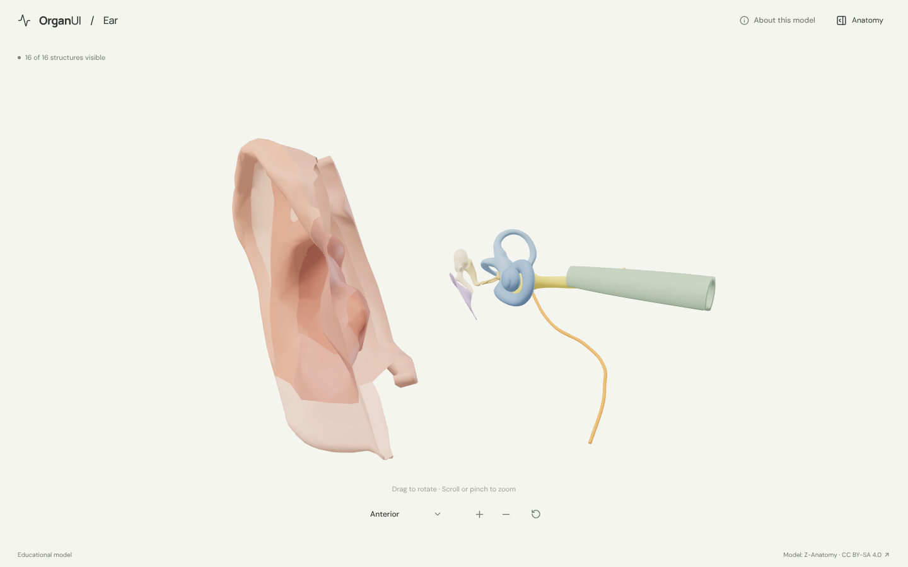
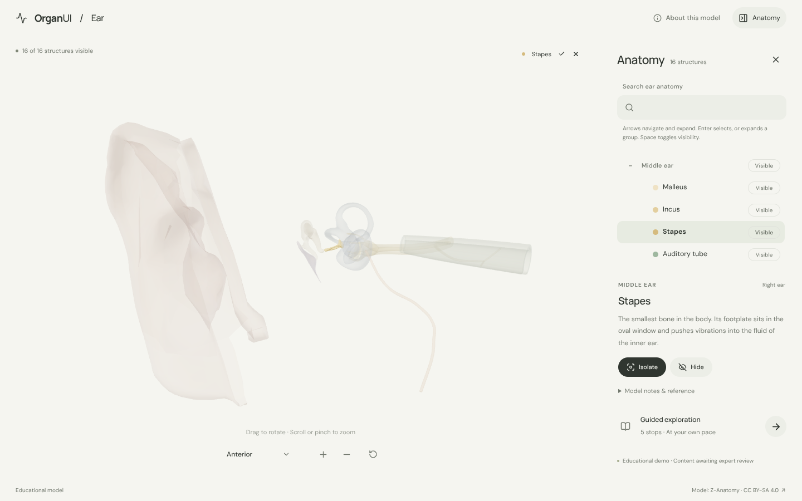
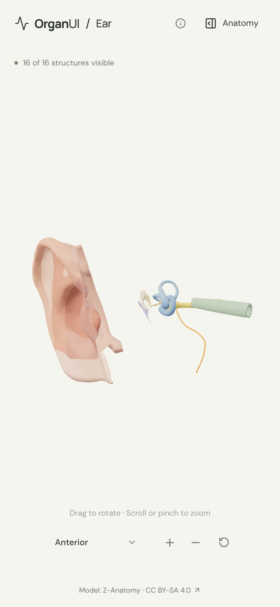

# OrganUI Ear

A minimal, standalone, open-source ear anatomy explorer built with React, TypeScript, Three.js, React Three Fiber, Vite, and Bun. It shares its interaction design and code with [OrganUI Heart](https://github.com/organui/heart-3d).

**Status:** working local demo. Sixteen selectable structures of the outer, middle and inner ear from a real, openly licensed model, responsive layouts, and checked desktop/mobile interactions. Public deployment and clinical anatomy review have not been completed.



## Run locally

Install [Bun](https://bun.sh/) **1.4.2 or newer**, then:

```sh
git clone https://github.com/organui/ear-3d.git
cd ear-3d
bun install --frozen-lockfile
bun run dev
```

Open **http://127.0.0.1:5173**. No environment variables, accounts, API keys, sibling repositories, model downloads, or external font services are needed after dependency installation. The ready-to-use 1.0 MB GLB is in `public/models/`.

```sh
bun run typecheck       # TypeScript checks, including conversion scripts
bun run test            # Unit tests for selection emphasis, picking, ownership, and the anatomy-tree adapter
bun run verify:model    # Check the GLB hash, source objects, and valid geometry
bun run build           # Typecheck and create dist/
bun run preview         # Serve the production build at http://127.0.0.1:4173
bun run format:check    # Check formatting
```

The app is static and uses relative build paths. No deployment has been performed.

## Explore

- The right ear opens in an anterior view: the auricle on the left, then the eardrum and ossicles, the cochlea and semicircular canals, and the auditory tube running toward the midline. Open **Anatomy** in the header to browse structures.
- Drag to rotate; scroll or pinch to zoom. The view menu has anterior, lateral and superior presets. Manual rotation changes its label to **Custom view**; zooming and selecting keep the view name.
- Select a mesh or use the anatomy tree (the OrganUI registry `anatomy-tree` component, see [registry integration](docs/REGISTRY_INTEGRATION.md)). The selected structure glows in its own colour and everything else is ghosted, so the small ossicles stay visible.
- Isolate a structure, hide it, or restore all. **Reset explorer** restores the anterior camera, visibility, selection, tree state and tour.
- Follow five guided stops, from the concha and the eardrum to the ossicles, the cochlea and the balance organ.
- Keyboard: Tab/Enter for controls, arrow keys to rotate the focused model, `+`/`-` to zoom, Escape closes the panel and returns focus to its toggle.

<details>
<summary>Selection and mobile screenshots</summary>





</details>

## Model, credits, and license

> Z-Anatomy, licensed under Creative Commons Attribution-ShareAlike 4.0, based in part on BodyParts3D / Anatomography, © The Database Center for Life Science (DBCLS). Adapted by OrganUI.

The model is a curated subset of **[Z-Anatomy](https://github.com/LluisV/Z-Anatomy)**: 31 right-ear objects grouped into 16 structures. BodyParts3D, which the other explorers use, has no middle or inner ear. The model data and screenshots of it are under **[CC BY-SA 4.0](https://creativecommons.org/licenses/by-sa/4.0/)**, separately from this repository's **MIT code license**. Source files are pinned to a commit and checked by SHA-256. Read [model provenance](docs/MODEL_PROVENANCE.md), [asset attribution](public/models/ATTRIBUTION.md) and the [manifest](public/models/manifest.json).

Descriptions summarise the [NIDCD page on how we hear](https://www.nidcd.nih.gov/health/how-do-we-hear) and general anatomy. **Expert anatomical review is pending.** This is an educational interface demonstration, not a diagnostic or clinical tool.

Known limitations:

- The auricle is a low-poly skin surface split into regions, so it looks faceted. Its cartilage is not modelled.
- The ear canal, the air space of the middle ear, the temporal bone, the ossicular ligaments and muscles, and the membranous labyrinth are not in the model. There are visible gaps between the concha and the eardrum, and between the middle ear and the auditory tube.
- The semicircular canals are part of the vestibule mesh and cannot be selected on their own. Colours are illustrative.
- Browser checks used headless Chromium with software WebGL at desktop and phone viewport sizes, not physical devices or a screen-reader audit.

## License

Original application code: [MIT](LICENSE). Anatomy model, derived model images, fonts, and icons retain their separately documented licenses.

Part of [OrganUI](https://github.com/organui).
